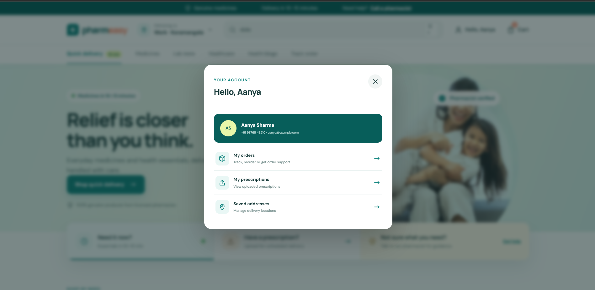

# Kalakriti 2026 — PharmEasy Quick-Commerce Redesign

**Theme:** Health & Well-Being
**Scenario:** PharmEasy — Transition into 10–15 minute quick-commerce medicine delivery

## 1. Quick-Commerce Home Screen

*Reasoning: [why this layout — what's prioritized above the fold, how urgency/ETA is surfaced without inducing anxiety, color logic used]*

## 2. Product / Category Browse

*Reasoning: [how urgent vs. non-urgent items are visually differentiated, how search/discovery is structured]*

## 3. Cart & Checkout

*Reasoning: [why prescription-upload flow is kept intact, trust cues around medical safety, accessibility considerations in the address/cart flow]*

## 4. Live Order Tracking

*Reasoning: [how time-critical info like ETA is prioritized, how attention is directed without clutter]*

## Additional Screens (Supporting Flows)

*These extend the core flow — e.g. self-service help/support for users in urgent situations, health content for trust-building, and profile/account management.*

## Target Userbase
[Who orders medicines urgently, and how the design accounts for their state of mind]

## Accessibility Considerations
[Elderly users, users in a medical emergency state — what specific choices address this]
